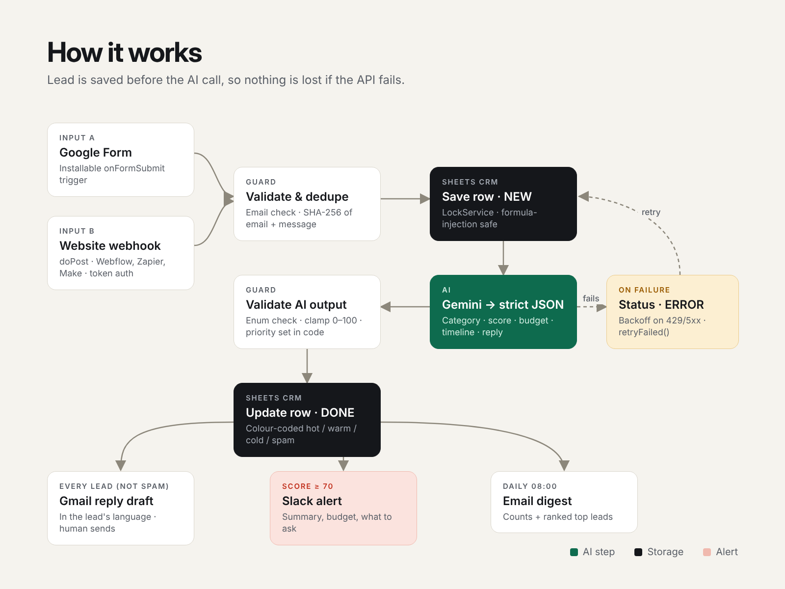

# AI Lead Intake — Google Forms / Webhook → Gemini → Sheets CRM → Gmail + Slack

Every inbound lead is **qualified by AI within seconds**: categorized, scored 0–100, budget and timeline extracted, a personalised reply drafted in Gmail, and the team pinged in Slack when a hot lead arrives. Runs entirely on Google Apps Script — no servers, no monthly SaaS fees.



## The problem

Small agencies and service businesses get leads from website forms, mixed with spam, support requests and $20 jobs. Someone reads each one, copies it into a spreadsheet, decides if it is worth it and writes a reply. Good leads wait hours; by then they have contacted a competitor.

## What it does

| Step | Details |
|---|---|
| **Capture** | Google Form (installable trigger) **or** any website form / Webflow / Zapier / Make via a `doPost` webhook with a shared-secret token |
| **Qualify** | Gemini returns strict JSON (response schema): category, score 0–100, budget, timeline, company, one-line summary, missing info, language |
| **Store** | Google Sheets as a lightweight CRM: one row per lead, colour-coded priority, full log sheet |
| **Reply** | Personalised reply **draft** in Gmail, in the lead's language, asking for the missing details. A human always presses Send |
| **Alert** | Slack message for hot leads (score ≥ 70) with summary, budget and what to ask |
| **Report** | Daily email digest: hot / warm / cold / spam counts and ranked top leads |

## Built for production, not just a demo

- **Never loses a lead** — the row is saved *before* the AI call. If Gemini fails, the row is marked `ERROR` and `retryFailed()` re-processes it.
- **Retries with exponential backoff** on `429` and `5xx`; fails fast on other `4xx`.
- **Deduplication** — SHA-256 of email + message, so double clicks and webhook retries don't create duplicates or extra AI calls.
- **Concurrency-safe** — `LockService` around check-and-append only, never around the slow AI call.
- **AI output is validated, not trusted** — enum check, score clamped to 0–100, priority computed in code from configurable thresholds.
- **Prompt-injection aware** — form text is passed as delimited data; the model is told not to follow instructions inside it, and scoring rules stay in code.
- **Formula-injection safe** — values starting with `= + - @` are escaped before they reach Sheets.
- **Side effects are isolated** — a Slack outage is logged as a warning and doesn't fail the lead.
- **Secrets in Script Properties**, never in code.
- **11 automated tests** run the real `.gs` files locally in Node with mocked Google services.

## Setup (≈10 minutes)

1. Create a Google Sheet → **Extensions → Apps Script**. Copy the files from `src/` (enable *Show appsscript.json* in Project Settings to paste the manifest).
2. **Project Settings → Script properties**:
   - `GEMINI_API_KEY` — from [Google AI Studio](https://aistudio.google.com/apikey) *(required)*
   - `SLACK_WEBHOOK_URL` — Slack incoming webhook *(optional)*
   - `WEBHOOK_TOKEN` — any random string, protects the web endpoint *(optional, recommended)*
   - `OWNER_EMAIL` — digest recipient *(optional, defaults to you)*
3. Edit `CONFIG` in `Config.gs`: business name, services, ideal client, signature.
4. Run `setup()` once and approve permissions. It creates the sheets, formatting and triggers.
5. Run `testWithSamples()` to push 8 realistic sample leads through the pipeline (hot, warm, cold, support, spam, prompt injection, Norwegian, invalid).
6. Connect a source:
   - **Google Form:** Form → Responses → *Link to Sheets* → this spreadsheet. Question titles are matched in `CONFIG.FORM_FIELDS`.
   - **Website / Zapier / Make:** Deploy → *New deployment* → Web app, then POST JSON:

```bash
curl -L -X POST "https://script.google.com/macros/s/DEPLOYMENT_ID/exec" \
  -H "Content-Type: application/json" \
  -d '{"token":"YOUR_TOKEN","name":"Laura","email":"laura@example.com","company":"Bright Dental","message":"New website with booking, budget $6k, deadline March 1"}'
# → {"ok":true,"id":"a1b2c3d4e5f6","status":"DONE"}
```

## Project structure

```
src/
  Config.gs      business settings, columns, secrets helper
  Main.gs        entry points (onFormSubmit, doPost, retryFailed) and the pipeline
  Gemini.gs      prompt, JSON schema, retries, output validation
  Sheets.gs      Sheets-as-CRM helpers, column lookup by header name, logging
  Actions.gs     Gmail draft, Slack alert, daily digest
  Setup.gs       one-click setup, sample leads
  appsscript.json
test/
  run-tests.js   node test/run-tests.js
```

## Customisation ideas

- Push qualified leads to HubSpot, Pipedrive, Airtable or Notion instead of / in addition to Sheets
- Telegram or Microsoft Teams alerts instead of Slack
- Auto-book a call link (Calendly / Google Calendar) for hot leads
- Different scoring rules per service or per form

## Limitations

- Apps Script quotas apply (UrlFetch calls, Gmail drafts per day). Fine for hundreds of leads a day, not for tens of thousands.
- Scores are only as good as the `IDEAL_CLIENT` description — tune it on real leads during the first week.
